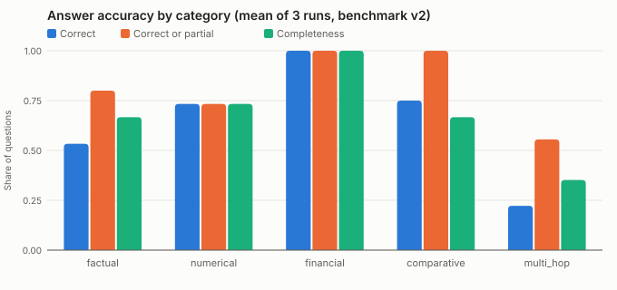

# Answer and citation quality evaluation

_Generated by `scripts/evaluate_answers.py`. Do not edit by hand; re-run the script._

- Generated: 2026-11-15T14:34:54+00:00 (pipeline runs: 2026-11-15T14:33:27+00:00)
- Pipeline: app/main.py: hybrid top 20 -> rerank top 5 -> generate -> select_citations(3) -> validate_citation
- LLM: llama3.2:3b (production defaults (no temperature/seed override)); 3 runs of every question
- Benchmark: `benchmark_v2.json` (primary); v1 shown where it differs
- Pipeline errors: 0
- Grading is deterministic (`app/evaluation/answer_checks.py`), independent of the system's own validator. No LLM judge.

## Summary (measured; mean over runs, range in brackets)

| Metric | Value |
| --- | ---: |
| Answer accuracy (correct) | 0.682 (0.636–0.727) |
| Correct or partially correct | 0.833 (0.818–0.864) |
| Mean completeness | 0.715 (0.678–0.739) |
| False abstention rate (answerable) | 0.045 |
| Pipeline error rate | 0.000 |
| Citation precision (micro) | 0.393 (0.383–0.407) |
| Citation precision (macro) | 0.410 (0.389–0.429) |
| Citation fact recall | 0.984 (0.952–1.000) |
| Answers with no citation (count per run) | 0 |
| Matched numeric facts whose value is in a cited passage | 0.744 (0.733–0.765) |
| Answers with a number not in any cited passage (count per run) | 2.667 (2–3) |
| Answers with a number not in the generator context (count per run) | 1 |
| Context fact recall (facts with a page in the 5 context chunks; all answerable) | 0.977 |
| System validator: supported claim rate | 0.783 (0.722–0.828) |
| System validator: unsupported claim rate | 0.150 (0.111–0.172) |
| System validator: insufficient-evidence claim rate | 0.067 (0.000–0.167) |
| Unanswerable: correct abstention rate | 1.000 |
| Unanswerable: false answer rate | 0.000 |
| Unanswerable: citations shown | 0.000 |

Definitions: *correct* = every expected fact matched on value, unit, period and entity (comparative: right direction and both values or the change; derived: result within tolerance). *Citation precision* = cited pages that are relevant pages. *Citation fact recall* = facts with at least one cited page among the pages that state them. *System validator* rates come from the pipeline's own claim validation, reported for transparency: it is part of the system under test.

Benchmark v1 differs only in Q017/Q018 fact pages; v1 citation precision (micro) 0.365 (0.356–0.373), citation fact recall 0.936 (0.905–0.952); answer accuracy is unaffected (0.682 (0.636–0.727)).

## By category

| Category | Accuracy | Correct or partial | Completeness |
| --- | ---: | ---: | ---: |
| factual | 0.533 (0.400–0.600) | 0.800 | 0.667 (0.600–0.700) |
| numerical | 0.733 (0.600–0.800) | 0.733 (0.600–0.800) | 0.733 (0.600–0.800) |
| financial | 1.000 | 1.000 | 1.000 |
| comparative | 0.750 | 1.000 | 0.667 (0.625–0.750) |
| multi_hop | 0.222 (0.000–0.333) | 0.556 (0.333–0.667) | 0.352 (0.306–0.417) |

## Per question (labels per run)

Stable across runs: 18 of 22 answerable questions.

| ID | Category | Labels (run 1/2/…) | Cited pages (run 1) | Cit. precision (run 1) | Validator (run 1) | Numbers not in context (run 1) |
| --- | --- | --- | --- | ---: | --- | --- |
| Q001 | factual | incorrect / incorrect / incorrect | 3, 26, 4 | 0.333 | SUPPORTED |  |
| Q002 | factual | partially_correct / partially_correct / partially_correct | 203, 94, 201 | 0.667 | INSUFFICIENT_EVIDENCE | 6 |
| Q003 | factual | correct / correct / correct | 111, 107, 113 | 0.333 | SUPPORTED |  |
| Q004 | factual | correct / correct / correct | 3, 7, 26 | 0.333 | SUPPORTED |  |
| Q005 | factual | partially_correct / correct / correct | 3, 69, 268 | 0.333 | SUPPORTED |  |
| Q006 | numerical | correct / correct / correct | 95, 203, 101 | 0.333 | SUPPORTED |  |
| Q007 | numerical | correct / correct / correct | 130 | 1.000 | SUPPORTED |  |
| Q008 | numerical | correct / correct / incorrect | 3, 65, 63 | 0.333 | UNSUPPORTED |  |
| Q009 | numerical | incorrect / incorrect / incorrect | 59, 69, 3 | 0.333 | UNSUPPORTED |  |
| Q010 | numerical | correct / correct / correct | 29, 30, 26 | 0.333 | SUPPORTED |  |
| Q011 | financial | correct / correct / correct | 95, 98, 94 | 0.333 | SUPPORTED |  |
| Q012 | financial | correct / correct / correct | 172, 203 | 0.500 | UNSUPPORTED |  |
| Q013 | financial | correct / correct / correct | 102, 98, 173 | 0.333 | SUPPORTED |  |
| Q014 | financial | correct / correct / correct | 67, 102, 16 | 0.333 | SUPPORTED |  |
| Q015 | financial | correct / correct / correct | 99, 100, 98 | 0.333 | SUPPORTED |  |
| Q016 | comparative | correct / correct / correct | 95, 101 | 0.500 | SUPPORTED |  |
| Q017 | comparative | correct / correct / correct | 95, 26, 3 | 0.667 | SUPPORTED |  |
| Q018 | comparative | partially_correct / partially_correct / partially_correct | 97, 59, 3 | 0.333 | SUPPORTED |  |
| Q019 | comparative | correct / correct / correct | 95, 101, 98 | 0.333 | SUPPORTED |  |
| Q020 | multi_hop | abstained / abstained / abstained | — | — | ABSTAINED |  |
| Q021 | multi_hop | correct / correct / partially_correct | 130, 246, 95 | 0.667 | SUPPORTED |  |
| Q022 | multi_hop | partially_correct / incorrect / partially_correct | 3, 91, 26 | 0.333 | UNSUPPORTED |  |

## Answers and grading detail (run 1)

- **Q001** (incorrect): "ArcelorMittal's primary business is steel production and processing, with a focus on selling its products in local markets and distribution of long and flat products as well as value-added and customized steel solutions."
  - primary_business: 'integrated steel and mining company' not stated
- **Q002** (partially_correct): "ArcelorMittal's reportable segments are: \n\n1. North America\n2. Brazil\n3. Europe\n4. India and JVs\n5. Sustainable Solutions and Mining\n6. Others."
  - reportable_segment_count: count not stated
- **Q003** (correct): 'Aditya Mittal is the Chief Executive Officer of ArcelorMittal, as of December 31, 2025.'
- **Q004** (correct): 'ArcelorMittal was incorporated under the laws of the Grand Duchy of Luxembourg on June 8, 2001.'
- **Q005** (partially_correct): 'Two predecessor companies, Mittal Steel Company N.V. and Arcelor, merged to form ArcelorMittal.'
  - merger_year: value not stated
- **Q006** (correct): "ArcelorMittal's total sales in 2025 were $61.4 billion."
- **Q007** (correct): 'As of December 31, 2025, ArcelorMittal employed approximately 125,554 full time equivalent ("FTE") employees directly, as well as a large number of contractors.'
- **Q008** (correct): 'Crude steel production was 55.6 million tonnes in 2025.'
- **Q009** (incorrect): "ArcelorMittal's iron ore production in 2025 totaled approximately 112.3 million tonnes."
  - iron_ore_production: expected value not stated (rounding-consistent, >= 2 significant figures)
- **Q010** (correct): 'ArcelorMittal spent $335 million on R&D expense in 2025.'
- **Q011** (correct): "ArcelorMittal's $3.6 billion operating income in 2025."
- **Q012** (correct): 'Cost of sales in 2025 was $56,976 million.'
- **Q013** (correct): "ArcelorMittal's net income attributable to equity holders of the parent was $3.2 billion in 2025."
- **Q014** (correct): "ArcelorMittal's total capital expenditures in 2025 were $4.3 billion."
- **Q015** (correct): "At December 31, 2025, ArcelorMittal's net debt was $7.9 billion."
- **Q016** (correct): "ArcelorMittal's total sales decreased by 1.7% between 2024 and 2025, from $62.4 billion in 2024 to $61.4 billion in 2025."
  - direction decrease (expected decrease), change stated: abs no, % yes
- **Q017** (correct): "ArcelorMittal's steel shipments remained relatively stable between 2024 and 2025, with a decrease of 0.3 million tonnes (0.6%) from 54.3 million tonnes in 2024 to 54.0 million tonnes in 2025."
  - direction decrease (expected decrease), change stated: abs yes, % yes
- **Q018** (partially_correct): "ArcelorMittal's iron ore production increased by 26.5% in 2025 compared to 2024, totaling approximately 35.3 million tonnes in 2025."
  - iron_ore_production: expected value not stated (rounding-consistent, >= 2 significant figures); iron_ore_production: expected value not stated (rounding-consistent, >= 2 significant figures); direction increase (expected increase), change stated: abs no, % no
- **Q019** (correct): "ArcelorMittal's operating income increased from $3.3 billion in 2024 to $3.6 billion in 2025. The main reason for this increase was a $1.9 billion gain upon acquisition of the remaining 50% equity stake in AMNS Calvert, partly offset by a $0.4 billion expense for the final settlement of the purchase price of Votorantim's long business in Brazil."
  - direction increase (expected increase), change stated: abs no, % no
- **Q020** (abstained): 'I could not find this information in the provided document.'
- **Q021** (correct): 'To calculate the average sales per employee in 2025, we need to divide the total sales by the total number of employees.\n\nTotal sales in 2025: $61,352 million\nTotal employees in 2025: approximately 125,554 FTE employees\n\nAverage sales per employee in 2025: $61,352 million / 125,554 FTE employees = approximately $0.49 million per employee'
  - derived result stated: yes
- **Q022** (partially_correct): "In 2025, ArcelorMittal's crude steel production was higher than its steel shipments. The crude steel production was 7,755 thousand tonnes, while the steel shipments were 10,283 thousand tonnes."
  - crude_steel_production: expected value not stated (rounding-consistent, >= 2 significant figures); steel_shipments: expected value not stated (rounding-consistent, >= 2 significant figures); derived result stated: no, direction ok: yes

## Unanswerable questions

See `abstention_report.md` for per-run detail.
