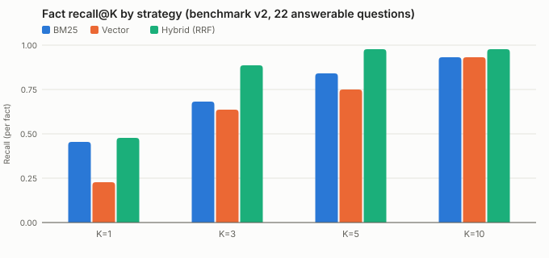
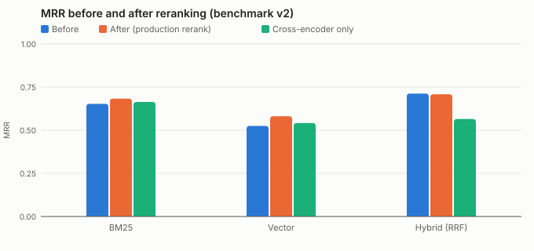
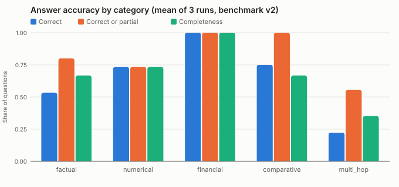

# InsightRAG Phase 2: evaluation report

_Generated by `scripts/build_phase2_report.py` on 2026-11-15T14:36:51+00:00 from the JSON files in `data/evaluation/results/`. Sections marked **Qualitative** are hand-written (`data/evaluation/phase2_findings.md`); everything else is generated from measured results._

**How to read this report.** *Measured* = produced by running the system and scoring it. *Calculated* = derived from measured values (differences, best-of, rates). *Qualitative* = human reading of the per-question outputs. *Limitations and assumptions* are listed in section 12.

## 1. Executive summary

### Measured headline numbers (benchmark v2)

| Measure | Value |
| --- | ---: |
| Retrieval MRR: hybrid / BM25 / vector (no rerank) | 0.712 / 0.653 / 0.525 |
| Retrieval fact recall@5: hybrid / BM25 / vector | 0.977 / 0.841 / 0.750 |
| Production retrieval (hybrid + rerank): MRR, recall@5 | 0.708, 0.977 |
| Answer accuracy (22 answerable, mean of 3 runs) | 0.682 (range 0.636–0.727) |
| Correct or partially correct | 0.833 (range 0.818–0.864) |
| Citation precision (micro) | 0.393 (range 0.383–0.407) |
| Citation fact recall | 0.984 (range 0.952–1.000) |
| Numeric facts fully matched (value, unit, period, entity) | 0.712 (range 0.682–0.773) |
| Correct abstention on unanswerable questions | 1.000 |
| False answers on unanswerable questions | 0.000 |
| False abstentions on answerable questions | 0.045 |

### Qualitative summary

- **Retrieval is the strongest part of the system.** Hybrid RRF beats both
  single retrievers on MRR and recall at every K. The production stage
  (hybrid + rerank) places at least one relevant page in the top 5 for all 22
  answerable questions, and the five context chunks contain a page with every
  required fact for 21 of 22 questions (the exception is Q020).
- **Most wrong answers are generation errors, not retrieval misses.** The
  LLM often takes a *segment* or *alternative-measure* figure from a correct
  neighbouring table instead of the consolidated figure: Mining-segment iron
  ore (35.3 Mt), North America crude steel (7,755 kt), run-of-mine aggregate
  iron ore (112.3 Mt).
- **Financial questions are answered reliably** (accuracy 1.00 in every run);
  production, shipment, comparative-change and multi-hop questions are not.
- **Abstention is conservative.** All 9 unanswerable trials abstained with no
  citations and no invented numbers. The cost is one answerable multi-hop
  question (Q020) that is refused in every run.
- **Citations are relevant but not precise.** Nearly every answered question
  cites at least one page that holds the fact (fact recall 0.98), but only
  about 40% of cited pages are relevant: of the 3 citations, typically about
  2 are neighbouring pages that do not hold the fact.
- **The built-in claim validator is not a reliable correctness signal.** It
  marks most wrong answers `SUPPORTED`, because the wrong number does appear
  in a cited passage, and marks some correct answers `UNSUPPORTED`.

## 2. Project and evaluation methodology

InsightRAG answers questions about one annual report with a local pipeline: pypdf extraction → 400-word chunks (100 overlap) → BAAI/bge-small-en-v1.5 embeddings in Qdrant + BM25 → weighted RRF fusion (0.4 BM25 / 0.6 vector, k = 60) with one chunk per page → cross-encoder rerank (ms-marco-MiniLM-L-6-v2, blended 0.7 first-stage / 0.3 cross-encoder) → top 5 chunks to llama3.2:3b (Ollama) → evidence selection (3 citations) → claim-level citation validation and abstention.

| Stage evaluated | Script | Method |
| --- | --- | --- |
| Retrieval metrics | `scripts/evaluate_retrieval.py` | Recall/Page recall/Precision@K and MRR over distinct (source, page) units |
| Strategy comparison | `scripts/compare_retrieval.py` | BM25, vector, hybrid on one shared index and expanded query; each reduced to its top 20 distinct pages |
| Reranker | `scripts/compare_retrieval.py` | Same pools before/after the production reranker and the cross-encoder alone |
| Answers, citations, numbers, abstention | `scripts/evaluate_answers.py` | Full production pipeline, 3 runs per question; deterministic grading, no LLM judge |
| This report | `scripts/build_phase2_report.py` | Reads the JSON results only |

Every evaluation can be re-scored without models from the saved raw outputs (`results/retrieval_runs.json`, `results/answer_runs.json`).

## 3. Benchmark

| Version | File | Questions | Verbatim excerpts | Role |
| --- | --- | ---: | ---: | --- |
| v1 | `benchmark_v1.json` | 25 | 48 | Original; immutable baseline |
| v2 | `benchmark_v2.json` | 25 | 52 | Primary; adds page 3 as alternative evidence for Q017/Q018 |

Categories: factual 5, numerical 5, financial 5, comparative 4, multi_hop 3, unanswerable 3. 22 answerable, 3 unanswerable. The v2 change was verified from the PDF's drawing instructions (`scripts/verify_chart_mapping.py`, see `benchmark_v2_changes.md`).

## 4. Retrieval strategy comparison (measured)

K = 1, 3, 5, 10 distinct pages; R = fact recall, PR = page recall, P = precision.

| Strategy | R@1 | R@3 | R@5 | R@10 | PR@5 | P@3 | Hit@1 | Hit@3 | MRR |
| --- | ---: | ---: | ---: | ---: | ---: | ---: | ---: | ---: | ---: |
| BM25 | 0.455 | 0.682 | 0.841 | 0.932 | 0.651 | 0.273 | 0.500 | 0.727 | 0.653 |
| Vector | 0.227 | 0.636 | 0.750 | 0.932 | 0.500 | 0.242 | 0.273 | 0.682 | 0.525 |
| Hybrid (RRF) | 0.477 | 0.886 | 0.977 | 0.977 | 0.682 | 0.348 | 0.545 | 0.909 | 0.712 |

Calculated: questions with no relevant page in the top 3: BM25: Q001, Q009, Q011, Q012, Q018, Q022; Vector: Q010, Q011, Q012, Q014, Q017, Q018, Q022; Hybrid (RRF): Q012, Q019.

Benchmark correction impact (calculated, MRR v1 → v2): BM25 0.653 → 0.653; Vector 0.511 → 0.525; Hybrid (RRF) 0.667 → 0.712; BM25 + rerank 0.683 → 0.683; Vector + rerank 0.570 → 0.581; Hybrid + rerank (production) 0.691 → 0.708; BM25 + CE only 0.664 → 0.664; Vector + CE only 0.535 → 0.541; Hybrid + CE only 0.565 → 0.565.

Task 2 baseline check: hybrid+rerank on v1 gives MRR 0.691 vs Task 2 0.691; all recall/page-recall/precision values identical.

Full detail: `retrieval_strategy_comparison.md`.

### Qualitative

- **Hybrid is best overall** and the most robust: it has no question without
  a relevant page in the top 10, and only two (Q012, Q019) without one in the
  top 3. BM25 and vector fail on different questions, which is exactly what
  fusion exploits.
- **BM25 fails on conceptual wording.** Q001 ("primary business") has its
  first relevant page at rank 19 for BM25, but rank 1 for vector. Q009 and
  Q022 are also late (ranks 9 and 6), because the many tables repeating
  "production" and "tonnes" outscore the consolidated table.
- **Vector search fails on exact financial line items.** Cost of sales (Q012,
  rank 15), R&D (Q010, rank 10), shipments (Q017, rank 9), operating income
  (Q011, rank 8) and capex (Q014, rank 7). Table rows with numbers embed
  poorly with a small general-purpose embedding model; BM25 finds these by
  their exact labels.
- **Precision is low for every strategy by design:** most questions have 1–3
  relevant pages, so P@10 cannot exceed about 0.1–0.3. Compare strategies on
  precision, not against 1.0.
- **Benchmark v2 changed only Q017/Q018,** which raised MRR slightly for the
  strategies that retrieve page 3. The Task 2 baseline is reproduced exactly
  on v1, which confirms the comparison harness matches the earlier evaluation.

## 5. Reranker comparison (measured)

| Comparison | MRR before → after | Hit@1 before → after | Hit@3 before → after | R@3 Δ | Improved / degraded / unchanged |
| --- | ---: | ---: | ---: | ---: | ---: |
| bm25 -> bm25+rerank | 0.653 → 0.683 (+0.030) | 0.500 → 0.500 | 0.727 → 0.818 | +0.091 | 6 / 0 / 16 |
| bm25 -> bm25+ce | 0.653 → 0.664 (+0.011) | 0.500 → 0.455 | 0.727 → 0.864 | +0.159 | 10 / 6 / 6 |
| vector -> vector+rerank | 0.525 → 0.581 (+0.056) | 0.273 → 0.364 | 0.682 → 0.727 | +0.068 | 8 / 0 / 14 |
| vector -> vector+ce | 0.525 → 0.541 (+0.017) | 0.273 → 0.318 | 0.682 → 0.727 | +0.045 | 9 / 8 / 5 |
| hybrid -> hybrid+rerank | 0.712 → 0.708 (-0.004) | 0.545 → 0.500 | 0.909 → 0.955 | +0.045 | 4 / 4 / 14 |
| hybrid -> hybrid+ce | 0.712 → 0.565 (-0.147) | 0.545 → 0.318 | 0.909 → 0.818 | -0.091 | 5 / 10 / 7 |

Questions where the production rerank moved relevant evidence down: bm25 -> bm25+rerank: Q006, Q008; vector -> vector+rerank: Q002, Q006, Q007, Q017; hybrid -> hybrid+rerank: Q002, Q006, Q007, Q008, Q014, Q017, Q018.

Full detail: `reranker_evaluation.md`.

### Qualitative

- **The production blend (0.7 first-stage + 0.3 cross-encoder) is roughly
  neutral on hybrid:** 4 questions improved, 4 degraded, MRR −0.004, Hit@1
  −0.045, Hit@3 +0.045. It never degrades a BM25 or vector ranking and
  improves 6 and 8 questions respectively, so it helps weaker first stages more.
- **The cross-encoder alone hurts hybrid substantially** (MRR −0.147, 10
  questions degraded). MS MARCO MiniLM is trained on web passages and ranks
  narrative text above dense financial tables, which is where most answers
  are. The 0.7 weight on the first-stage score is what keeps the production
  reranker from doing harm; increasing the cross-encoder weight would be a regression.
- **Where the first relevant page moved down with the production rerank:**
  Q006 and Q008 (rank 1 → 2), Q014 (2 → 3), Q018 (1 → 2). Secondary relevant
  pages also moved down in Q002, Q007 and Q017 without changing the first hit. These are table-heavy pages
  displaced by narrative pages. Gains: Q011 (3 → 1) and Q019 (4 → 1), both
  questions whose answer is stated in narrative text.

## 6. Answer correctness (measured)

| Measure | Value |
| --- | ---: |
| Correct | 0.682 (range 0.636–0.727) |
| Correct or partially correct | 0.833 (range 0.818–0.864) |
| Mean completeness | 0.715 (range 0.678–0.739) |
| False abstention | 0.045 |
| Answers with a number not in the generator's context (count per run) | 1 |
| Context fact recall (ceiling for the generator) | 0.977 |
| Questions with the same label in every run | 18 of 22 |

| ID | Category | Labels per run |
| --- | --- | --- |
| Q001 | factual | incorrect / incorrect / incorrect |
| Q002 | factual | partially_correct / partially_correct / partially_correct |
| Q003 | factual | correct / correct / correct |
| Q004 | factual | correct / correct / correct |
| Q005 | factual | partially_correct / correct / correct |
| Q006 | numerical | correct / correct / correct |
| Q007 | numerical | correct / correct / correct |
| Q008 | numerical | correct / correct / incorrect |
| Q009 | numerical | incorrect / incorrect / incorrect |
| Q010 | numerical | correct / correct / correct |
| Q011 | financial | correct / correct / correct |
| Q012 | financial | correct / correct / correct |
| Q013 | financial | correct / correct / correct |
| Q014 | financial | correct / correct / correct |
| Q015 | financial | correct / correct / correct |
| Q016 | comparative | correct / correct / correct |
| Q017 | comparative | correct / correct / correct |
| Q018 | comparative | partially_correct / partially_correct / partially_correct |
| Q019 | comparative | correct / correct / correct |
| Q020 | multi_hop | abstained / abstained / abstained |
| Q021 | multi_hop | correct / correct / partially_correct |
| Q022 | multi_hop | partially_correct / incorrect / partially_correct |

Full detail (answers, grading reasons): `answer_quality_report.md`.

## 7. Citation quality (measured)

| Measure | v2 | v1 |
| --- | ---: | ---: |
| Citation precision (micro) | 0.393 (range 0.383–0.407) | 0.365 (range 0.356–0.373) |
| Citation precision (macro) | 0.410 (range 0.389–0.429) | 0.384 (range 0.373–0.397) |
| Citation fact recall | 0.984 (range 0.952–1.000) | 0.936 (range 0.905–0.952) |
| Matched numeric facts whose value appears in a cited passage | 0.744 (range 0.733–0.765) | — |
| Answers with a number not in any cited passage (count per run) | 2.667 (range 2–3) | — |
| System validator: supported claim rate | 0.783 (range 0.722–0.828) | — |
| System validator: unsupported claim rate | 0.150 (range 0.111–0.172) | — |
| System validator: insufficient-evidence claim rate | 0.067 (range 0.000–0.167) | — |

The *system validator* rows are the pipeline's own claim checks (part of the system under test); the other rows are independent deterministic checks against the benchmark.

## 8. Numerical accuracy (measured)

| Dimension | Rate |
| --- | ---: |
| value_found | 0.712 (range 0.682–0.773) |
| unit_ok | 0.712 (range 0.682–0.773) |
| period_ok | 1.000 |
| entity_ok | — |
| metric_named | 1.000 |
| matched | 0.712 (range 0.682–0.773) |
| rounded_share_of_matched | 0.423 (range 0.333–0.471) |

| Figure type | Facts | Matched |
| --- | ---: | ---: |
| employees | 2 | 1.000 |
| financial | 12 | 0.944 (range 0.833–1.000) |
| production | 5 | 0.133 (range 0.000–0.200) |
| shipments | 3 | 0.556 (range 0.333–0.667) |

| Comparison / derived check | Rate |
| --- | ---: |
| Direction correct (comparative) | 1.000 |
| Absolute change correct | 0.250 |
| Percent change correct | 0.417 (range 0.250–0.500) |
| Derived result within tolerance | 0.333 (range 0.000–0.500) |

Full detail: `numerical_evaluation.md`.

## 9. Abstention performance (measured)

| Measure | Value |
| --- | ---: |
| Unanswerable trials (questions × runs) | 9 |
| Correct abstention rate | 1.000 |
| False answer rate | 0.000 |
| Citations shown alongside a false answer | 0.000 |
| Trials with invented numbers | 0 |
| Trials with near-miss numbers copied from context | 0 |
| False abstention rate on answerable question-runs | 0.045 |

Full detail: `abstention_report.md`.

## 10. Category-level analysis (measured)

| Category | Retrieval MRR (hybrid+rerank) | Retrieval R@5 (hybrid+rerank) | Answer accuracy | Completeness |
| --- | ---: | ---: | ---: | ---: |
| factual | 0.900 | 1.000 | 0.533 (range 0.400–0.600) | 0.667 (range 0.600–0.700) |
| numerical | 0.533 | 1.000 | 0.733 (range 0.600–0.800) | 0.733 (range 0.600–0.800) |
| financial | 0.617 | 1.000 | 1.000 | 1.000 |
| comparative | 0.708 | 1.000 | 0.750 | 0.667 (range 0.625–0.750) |
| multi_hop | 0.833 | 0.833 | 0.222 (range 0.000–0.333) | 0.352 (range 0.306–0.417) |

### Qualitative

- **Financial (5/5 correct in every run):** single consolidated figures with
  distinctive labels; retrieval and generation both work, often with
  rounded billions ($3.6 billion, $4.3 billion), which the grader accepts as
  rounding-consistent.
- **Factual:** names and dates are right (CEO, incorporation), but Q001
  never says "mining", so it misses the "integrated steel and mining" answer.
  Q002 lists the segments with "Others" as if it were a segment or without
  the count, and Q005 omits the merger year in some runs.
- **Numerical:** employees, crude steel, R&D and sales are right; Q009 (iron
  ore production) is wrong in every run, because the run-of-mine aggregate
  112.3 Mt from page 70 is chosen while page 95 is not in the context.
- **Comparative:** the direction is right in every run, but the change
  values are often missing or wrong. Q018 uses the Mining-segment figures
  (35.3 vs 27.9 Mt, +26.5%) instead of the consolidated 48.8 vs 42.4 Mt.
- **Multi-hop (weakest):** Q020 abstains in every run (page 130 with
  segment headcount is not retrieved into the top 5). Q021's division is
  right in two of three runs. Q022 uses North America segment crude steel
  and in one run states the wrong direction.

## 11. Failure-case analysis (qualitative)

| Question | What went wrong | Stage | Evidence |
|---|---|---|---|
| Q009 iron ore production | Answers 112.3 Mt, the aggregate run-of-mine figure for 2025 (page 70), not ArcelorMittal's 48.8 Mt | Retrieval + generation | Context pages 69, 26, 3, 59, 70: page 95 absent; page 3 has 48.8 only as an unlabelled number run |
| Q018 iron ore change | Mining-segment 35.3 vs 27.9 Mt (+26.5%) instead of the consolidated 48.8 vs 42.4 Mt (+15.1%) | Generation (segment vs total) | Pages 97 and 59 state the segment figures explicitly; page 95 is not in the context |
| Q022 production vs shipments | North America crude steel 7,755 kt (page 96) compared with a 10,283 kt figure from another table; one run concludes "lower" | Generation | Context has the segment tables (91, 96) but no page 60 |
| Q020 largest segment workforce | Abstains in every run although sales (page 95) are in the context | Retrieval (page 130 missing from top 5) | Context pages 95, 204, 94, 132, 97 |
| Q008 crude steel (run 3) | States 54.0 Mt (the shipments figure) as crude steel production | Generation reading the flattened page 3 chart | Page 3 text is "55.6 48.8 54.0 61.4 …" with no labels in between |
| Q001 primary business | Describes steel only and omits mining in every run | Generation | Page 3 is retrieved (rank 2) and states "integrated steel and mining" |
| Validator false positives | 11 of 18 incorrect or partial question-runs are still `SUPPORTED` | Citation validation | The validator checks that a number appears in a cited passage, not that it is the right metric or scope |

The common pattern is **scope confusion**: the report contains many tables
with the same metric names at segment level, and the 3B model picks a
plausible but wrong table. Retrieval ranks those segment tables highly
because they share every query term.

## 12. Limitations and assumptions

- **Small benchmark:** 22 answerable and 3 unanswerable questions from one
  document. One question moves a category score by 20–33%. Treat category
  results as indicative.
- **Generation is non-deterministic:** the production generator sets no
  temperature or seed. Results are the mean of 3 runs with min–max ranges;
  18 of 22 answerable questions get the same label in every run (Q005, Q008,
  Q021 and Q022 vary).
  Three runs bound the variance only roughly.
- **Page-level relevance:** a retrieved page counts as relevant even when the
  chunk holds a different table from that page; retrieval metrics can overstate quality.
- **Deterministic grading is rule-based:** it checks values, units, years,
  segments, direction words and required terms. It does not judge the
  reasoning in free text (e.g. whether Q019's stated cause is complete) and
  can miss paraphrases such as a segment list written without the count.
  Every graded answer was also read by hand for this report. The one grader
  false positive found (list numbering "6." counted as "six segments") was
  fixed and covered by a test. No LLM judge was used.
- **Rounding policy:** rounding-consistent values with at least two
  significant figures are accepted ($3.2 billion for $3,152 million, $61
  billion for $61,352 million). A stricter policy would lower financial accuracy.
- **Unanswerable questions are few and clearly out of scope** (future year,
  a single day, an individual salary). The 100% abstention rate says little
  about harder near-miss questions.
- **Citation precision depends on the selector returning 3 citations.**
  Questions with one relevant page cap precision at about 0.33.
- **System validator rates** are reported for transparency but are part of
  the system under test, not ground truth.
- **Page 3 chart:** v2 credits page 3 for Q017/Q018 retrieval, but its
  extracted text is a flattened number run, so having it in the context does
  not mean the generator can use it (see Q008, run 3).

## 13. Recommendations (qualitative)

1. **Keep hybrid retrieval with the current 0.7/0.3 rerank blend.** Do not
   raise the cross-encoder weight or switch to cross-encoder-only ordering
   (measured −0.147 MRR on hybrid). Consider a reranker suited to tables, or
   try skipping reranking for table-heavy queries.
2. **Address scope confusion at generation time:** tell the model to prefer
   consolidated ("Total", group-level) figures unless a segment is named,
   and include each chunk's table header or section title in the excerpt
   text so "(Mining segment)" or "North America" is visible next to the numbers.
3. **Strengthen citation validation:** check that the cited passage states
   the same *metric and scope* as the claim (segment names, "aggregate ROM",
   "capacity"), not only the same number. This would catch most of the 11
   `SUPPORTED`-but-wrong cases.
4. **Improve multi-hop retrieval:** retrieve per sub-question (e.g. "segment
   employees" and "segment sales") or widen the context from 5 to 8 chunks
   for questions that combine two facts. Q020 fails only because page 130
   is outside the top 5.
5. **Make generation deterministic for evaluation** (temperature 0 and a
   fixed seed via an option on `Generator`) so that later comparisons
   measure system changes rather than sampling noise.
6. **Parse charts and tables with layout information:** the page 3 KPI
   chart and similar graphics lose their labels in pypdf text; the geometry
   approach in `scripts/verify_chart_mapping.py` shows that these can be recovered.
7. **Extend the benchmark** with near-miss unanswerable questions (e.g. a
   metric reported only for a segment) and more multi-hop questions before
   tuning against it, to avoid overfitting 25 questions.

## 14. Conclusions

InsightRAG's retrieval works for this report. Hybrid RRF is the best first
stage, and the production pipeline gets every needed fact page into the
generator's context for 21 of 22 answerable questions. End-to-end answer
accuracy is about two thirds (0.68 mean of three runs, strict grading); a
further sixth of answers are partially correct. Abstention on clearly
unanswerable questions is perfect, and no fabricated numbers were observed:
every wrong figure was copied from a real but inappropriate table. The
weakest points are the 3B model's choice between segment-level and
consolidated figures, multi-hop questions, and a citation validator that
confirms numbers without confirming their meaning. The evaluation framework
is now reproducible end to end: saved raw outputs can be re-scored without
models. That gives Phase 3 a baseline for measuring improvements to
generation prompting, scope-aware validation and multi-hop retrieval.

## Appendix: result files

| File | Content |
| --- | --- |
| `results/retrieval_evaluation*.json` | Task 2 baseline (production retrieval, v1) |
| `results/retrieval_runs.json` | Raw rankings for all 9 retrieval variants × 25 questions |
| `results/strategy_comparison*.json` | Task 3 scores (v2 and v1) |
| `results/reranker_evaluation*.json` | Task 4 before/after comparisons |
| `results/answer_runs.json` | Raw pipeline outputs (answers, context, citations, validation) for every run |
| `results/answer_evaluation*.json` | Task 5 grading per run and aggregated |
| `results/numerical_evaluation.json` | Task 6 numeric checks per fact and dimension |
| `results/abstention_evaluation.json` | Task 6 abstention detail |
| `results/phase2_summary.json` | Headline numbers of this report |
