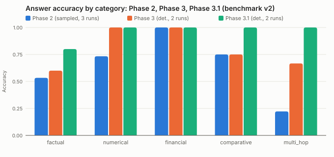

# InsightRAG Phase 3.1: evaluation report

_Generated by `scripts/build_phase3_1_report.py` on 2026-11-15T16:52:23+00:00 from saved results. Benchmark `benchmark_v2.json` (v1 and v2 unchanged). The **Qualitative** section is hand-written (`data/evaluation/phase3_1_findings.md`); all numbers come from the result files._

| Variant | Runs | Generation settings |
| --- | ---: | --- |
| Phase 2 (sampled, 3 runs) | 3 | production defaults (no temperature/seed override) |
| Phase 3 (det., 2 runs) | 2 | {"model": "llama3.2:3b", "options": {"temperature": 0.0, "seed": 42}, "options_applied": true, "scope_aware_prompt": true} |
| Phase 3.1 (det., 2 runs) | 2 | {"model": "llama3.2:3b", "options": {"temperature": 0.0, "seed": 42}, "options_applied": true, "scope_aware_prompt": true} |

## 1. Headline comparison (measured; Δ calculated)

| Metric | Phase 2 | Phase 3 | Phase 3.1 | Δ vs Phase 2 | Δ vs Phase 3 |
| --- | ---: | ---: | ---: | ---: | ---: |
| Answer accuracy (correct) | 0.682 (0.636–0.727) | 0.818 | 0.955 | +0.273 | +0.136 |
| Correct or partially correct | 0.833 (0.818–0.864) | 0.909 | 1.000 | +0.167 | +0.091 |
| Mean completeness | 0.715 (0.678–0.739) | 0.814 | 0.939 | +0.225 | +0.125 |
| Citation precision (micro) | 0.393 (0.383–0.407) | 0.407 | 0.429 | +0.035 | +0.022 |
| Citation fact recall | 0.984 (0.952–1.000) | 1.000 | 1.000 | +0.016 | +0.000 |
| Numeric facts fully matched | 0.712 (0.682–0.773) | 0.818 | 0.917 | +0.205 | +0.098 |
| Absolute change correct | 0.250 | 0.333 | 0.500 | +0.250 | +0.167 |
| Derived result within tolerance | 0.333 (0.000–0.500) | 0.500 | 1.000 | +0.667 | +0.500 |
| Context fact recall (5 chunks) | 0.977 | 1.000 | 1.000 | +0.023 | +0.000 |
| Unanswerable: correct abstention | 1.000 | 1.000 | 1.000 | +0.000 | +0.000 |
| Unanswerable: false answers | 0.000 | 0.000 | 0.000 | +0.000 | +0.000 |
| False abstention (answerable) | 0.045 | 0.045 | 0.000 | -0.045 | -0.045 |

## 2. Context retrieval (5 chunks given to the generator)

| Variant | Fact recall@5 | Page recall@5 | Precision@5 | MRR | Questions missing a fact page |
| --- | ---: | ---: | ---: | ---: | --- |
| Phase 2 (sampled, 3 runs) | 0.977 | 0.659 | 0.245 | 0.708 | Q020 |
| Phase 3 (det., 2 runs) | 1.000 | 0.682 | 0.255 | 0.708 | none |
| Phase 3.1 (det., 2 runs) | 1.000 | 0.727 | 0.264 | 0.716 | none |

## 3. Category-level accuracy

| Category | Phase 2 | Phase 3 | Phase 3.1 | Δ vs Phase 3 |
| --- | ---: | ---: | ---: | ---: |
| factual | 0.533 (0.400–0.600) | 0.600 | 0.800 | +0.200 |
| numerical | 0.733 (0.600–0.800) | 1.000 | 1.000 | +0.000 |
| financial | 1.000 | 1.000 | 1.000 | +0.000 |
| comparative | 0.750 | 0.750 | 1.000 | +0.250 |
| multi_hop | 0.222 (0.000–0.333) | 0.667 | 1.000 | +0.333 |

## 4. Per-question changes (majority label across runs)

Versus Phase 2: {'improved': 5, 'unchanged': 17}. Versus Phase 3: {'improved': 3, 'unchanged': 19}.

| ID | Category | Phase 2 | Phase 3 | Phase 3.1 | vs Phase 2 | vs Phase 3 |
| --- | --- | --- | --- | --- | --- | --- |
| Q001 | factual | incorrect / incorrect / incorrect | incorrect / incorrect | correct / correct | improved | improved |
| Q002 | factual | partially_correct / partially_correct / partially_correct | partially_correct / partially_correct | partially_correct / partially_correct | unchanged | unchanged |
| Q003 | factual | correct / correct / correct | correct / correct | correct / correct | unchanged | unchanged |
| Q004 | factual | correct / correct / correct | correct / correct | correct / correct | unchanged | unchanged |
| Q005 | factual | partially_correct / correct / correct | correct / correct | correct / correct | unchanged | unchanged |
| Q006 | numerical | correct / correct / correct | correct / correct | correct / correct | unchanged | unchanged |
| Q007 | numerical | correct / correct / correct | correct / correct | correct / correct | unchanged | unchanged |
| Q008 | numerical | correct / correct / incorrect | correct / correct | correct / correct | unchanged | unchanged |
| Q009 | numerical | incorrect / incorrect / incorrect | correct / correct | correct / correct | improved | unchanged |
| Q010 | numerical | correct / correct / correct | correct / correct | correct / correct | unchanged | unchanged |
| Q011 | financial | correct / correct / correct | correct / correct | correct / correct | unchanged | unchanged |
| Q012 | financial | correct / correct / correct | correct / correct | correct / correct | unchanged | unchanged |
| Q013 | financial | correct / correct / correct | correct / correct | correct / correct | unchanged | unchanged |
| Q014 | financial | correct / correct / correct | correct / correct | correct / correct | unchanged | unchanged |
| Q015 | financial | correct / correct / correct | correct / correct | correct / correct | unchanged | unchanged |
| Q016 | comparative | correct / correct / correct | correct / correct | correct / correct | unchanged | unchanged |
| Q017 | comparative | correct / correct / correct | correct / correct | correct / correct | unchanged | unchanged |
| Q018 | comparative | partially_correct / partially_correct / partially_correct | abstained / abstained | correct / correct | improved | improved |
| Q019 | comparative | correct / correct / correct | correct / correct | correct / correct | unchanged | unchanged |
| Q020 | multi_hop | abstained / abstained / abstained | correct / correct | correct / correct | improved | unchanged |
| Q021 | multi_hop | correct / correct / partially_correct | correct / correct | correct / correct | unchanged | unchanged |
| Q022 | multi_hop | partially_correct / incorrect / partially_correct | partially_correct / partially_correct | correct / correct | improved | improved |

## 5. Targeted questions (Phase 3.1, run 1)

| ID | Label | Context pages | Cited pages | Answer | Calculation operands | Completeness |
| --- | --- | --- | --- | --- | --- | --- |
| Q001 | correct | 25, 3, 70, 26, 31 | 26, 3, 31 | ArcelorMittal's primary business is integrated steel and mining. | — | complete; missing none; extra none |
| Q002 | partially_correct | 94, 201, 59, 203, 208 | 203, 94, 201 | ArcelorMittal's reportable segments are:  1. North America 2. Brazil 3. Europe 4. India and JVs 5. Sustainable Solutions 6. Mining 7. Others | — | incomplete; missing none; extra ['Others'] |
| Q018 | correct | 69, 95, 3, 78, 26 | 3, 95, 78 | Iron ore production increased by 6.4 million tonnes (15.1%), from 42.4 million tonnes in 2024 to 48.8 million tonnes in 2025. | Iron ore production (million tonnes)* = 42.4 (p3); Iron ore production (million tonnes)* = 48.8 (p3) | — |
| Q022 | correct | 3, 26, 65, 105, 63 | 3, 26, 65 | Crude steel production (55.6 million tonnes) was higher than steel shipments (54.0 million tonnes) in 2025, a difference of 1.6 million tonnes. | Crude steel production (million tonnes) = 55.6 (p3); Steel shipments (million tonnes) = 54.0 (p3) | — |

## 6. Numerical accuracy by figure type (numeric facts fully matched)

| Figure type | Phase 2 | Phase 3 | Phase 3.1 |
| --- | ---: | ---: | ---: |
| employees | 1.000 | 0.667 | 0.667 |
| financial | 0.944 (0.833–1.000) | 0.923 | 0.923 |
| production | 0.133 (0.000–0.200) | 0.667 | 1.000 |
| shipments | 0.556 (0.333–0.667) | 0.667 | 1.000 |

## 7. Programmatic calculations, revisions and completeness (Phase 3.1, measured)

Computed results (operands from evidence; never from the LLM):

| ID | Computed sentence |
| --- | --- |
| Q017 | Steel shipments decreased by 0.3 million tonnes (0.6%), from 54.3 million tonnes in 2024 to 54.0 million tonnes in 2025. |
| Q018 | Iron ore production increased by 6.4 million tonnes (15.1%), from 42.4 million tonnes in 2024 to 48.8 million tonnes in 2025. |
| Q022 | Crude steel production (55.6 million tonnes) was higher than steel shipments (54.0 million tonnes) in 2025, a difference of 1.6 million tonnes. |

Completeness checks (question-runs): Q001|complete × 2, Q002|incomplete × 2.

| Run | ID | First answer graded | Final graded | Reason (first) |
| ---: | --- | --- | --- | --- |
| 1 | Q001 | incorrect | correct | The document describes it as follows: "ArcelorMittal is one of the world’s leading integrated steel and mining companies |
| 1 | Q002 | partially_correct | partially_correct | The document lists 6 reportable segments: North America, Brazil, Europe, India and JVs, Sustainable Solutions, Mining. T |
| 1 | Q022 | partially_correct | correct | Arithmetic error: says 55.6 million is lower than 54.0 million. |
| 2 | Q001 | incorrect | correct | The document describes it as follows: "ArcelorMittal is one of the world’s leading integrated steel and mining companies |
| 2 | Q002 | partially_correct | partially_correct | The document lists 6 reportable segments: North America, Brazil, Europe, India and JVs, Sustainable Solutions, Mining. T |
| 2 | Q022 | partially_correct | correct | Arithmetic error: says 55.6 million is lower than 54.0 million. |

Answers replaced by abstention after contradiction: none.

Stability: 22/22 questions with the same label in both Phase 3.1 runs.

## 8. Findings and limitations (qualitative)

**Result.** Phase 3.1 answers 21 of 22 answerable questions correctly in both deterministic runs (0.955),
up from 0.818 in Phase 3 and 0.682 in Phase 2. Every answerable question is now at least partially correct
(1.000), and no question regressed against Phase 2 or Phase 3. Abstention on the unanswerable questions
is unchanged (3/3 refused, no citations, no invented numbers), and the one false abstention from Phase 3
(Q018) is gone.

**Q018, consolidated figure retrieval (fixed).** Cause: the question's own query ranks the Mining-segment
table (page 97) and narrative (page 59) above the consolidated performance table (page 95), which was at
rank 9 after reranking. Fix: change questions get one extra query shaped like the report's table header
("iron ore production 2025 2024 change % change"), with group-level chunks ordered first. Page 95 now
enters the context and is cited. The change is computed from consolidated evidence (42.4 → 48.8 Mt,
+6.4 Mt, +15.1%), and the Mining-segment sentence the model wrote first is dropped as a scope
contradiction. Questions that name a segment get no rewrite and keep segment evidence (tested).

**Q022, numerical calculation (fixed).** The difference is now computed in code from labelled evidence
values: 55.6 − 54.0 = 1.6 Mt, "higher". The operands come from the recovered page 3 chart, with metric,
unit and year checked. The model's own arithmetic ("lower ... 0.6 million tonnes") is replaced. If an
operand cannot be found with a matching metric, unit, year and scope, nothing is computed.

**Q001, completeness (fixed).** A definition-style rewrite ("ArcelorMittal company overview") retrieves the
"integrated steel and mining companies" sentence. The completeness check flags "steel production" as
missing "mining", and the single revision corrects it. Optional modifiers ("integrated") are not required,
so concise answers such as "a steel and mining company" pass.

**Q002, completeness (detected, not fixed).** The list check finds the document's enumeration ("six
reportable segments: …"), and the revision splits "Sustainable Solutions and Mining" correctly. The model
still adds "Others" as a seventh segment, and the check reports this as incomplete
(`validation["completeness"]`: extra = Others). Rewriting the answer from the evidence list in code would
fix it, but that goes beyond detection, so it was not done in this phase.

**Side effects measured.**

- **Q017:** the calculation re-states the same correct result (0.3 Mt, 0.6%).
- **Q016 and Q019:** no operand row matches the metric (their consolidated row is labelled "Total"), so they
  are unchanged and still correct.
- **Context:** page recall@5 rises from 0.682 to 0.727. Citation precision rises slightly (0.407 → 0.429)
  because operand pages are cited.

**Limitations.**

- Rewrites and calculations rely on two question shapes ("how did <metric> change between Y1 and Y2", "was
  A higher or lower than B") and on table layout ("<Y2> <Y1>" header rows, labels with units in
  parentheses). Other phrasings fall back to Phase 3 behaviour.
- Operands are found only in recovered chart values and labelled table rows. Narrative sentences and rows
  labelled "Total" are not used (Q016, Q019).
- The completeness check covers only enumerations with a stated count and copular definitions. It detects
  but does not repair; the result depends on the single revision.
- The results come from 22 answerable questions and 2 deterministic runs with the same seed. A different
  seed or model version may change individual answers, and 0.955 should not be read as a general accuracy
  figure.
