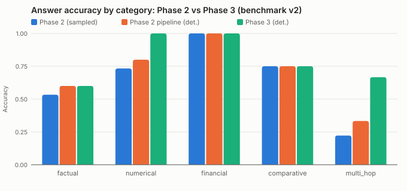

# InsightRAG Phase 3: evaluation report

_Generated by `scripts/build_phase3_report.py` on 2026-11-15T16:14:31+00:00 from saved results. Benchmark: `benchmark_v2.json` (v1 and v2 unchanged). The section marked **Qualitative** is hand-written (`data/evaluation/phase3_findings.md`); all numbers are measured or calculated from the result files._

## Variants compared

| Variant | Runs | Generation settings |
| --- | ---: | --- |
| Phase 2 (saved, sampled, 3 runs) | 3 | production defaults (no temperature/seed override) |
| Phase 2 pipeline, deterministic | 1 | {"model": "llama3.2:3b", "options": {"temperature": 0.0, "seed": 42}, "options_applied": true, "scope_aware_prompt": false} |
| Phase 3 pipeline, deterministic | 2 | {"model": "llama3.2:3b", "options": {"temperature": 0.0, "seed": 42}, "options_applied": true, "scope_aware_prompt": true} |

*Phase 2 pipeline (det.)* re-runs the Phase 2 configuration with the same deterministic settings as Phase 3, so **its column vs Phase 3 isolates the Phase 3 changes**; the saved Phase 2 column shows the original baseline.

## 1. Headline comparison (measured; Δ calculated)

| Metric | Phase 2 | Phase 2 pipeline (det.) | Phase 3 | Δ vs Phase 2 | Δ vs det. baseline |
| --- | ---: | ---: | ---: | ---: | ---: |
| Answer accuracy (correct) | 0.682 (0.636–0.727) | 0.727 | 0.818 | +0.136 | +0.091 |
| Correct or partially correct | 0.833 (0.818–0.864) | 0.818 | 0.909 | +0.076 | +0.091 |
| Mean completeness | 0.715 (0.678–0.739) | 0.727 | 0.814 | +0.100 | +0.087 |
| False abstention (answerable) | 0.045 | 0.045 | 0.045 | +0.000 | +0.000 |
| Citation precision (micro) | 0.393 (0.383–0.407) | 0.390 | 0.407 | +0.014 | +0.017 |
| Citation fact recall | 0.984 (0.952–1.000) | 1.000 | 1.000 | +0.016 | +0.000 |
| Matched numeric facts with value in a cited passage | 0.744 (0.733–0.765) | 0.733 | 0.778 | +0.034 | +0.045 |
| Numeric facts fully matched | 0.712 (0.682–0.773) | 0.682 | 0.818 | +0.106 | +0.136 |
| Comparison direction correct | 1.000 | 1.000 | 1.000 | +0.000 | +0.000 |
| Absolute change correct | 0.250 | 0.250 | 0.333 | +0.083 | +0.083 |
| Derived result within tolerance | 0.333 (0.000–0.500) | 0.500 | 0.500 | +0.167 | +0.000 |
| Context fact recall (5 chunks) | 0.977 | 0.977 | 1.000 | +0.023 | +0.023 |
| Unanswerable: correct abstention | 1.000 | 1.000 | 1.000 | +0.000 | +0.000 |
| Unanswerable: false answers | 0.000 | 0.000 | 0.000 | +0.000 | +0.000 |

## 2. Retrieval (measured)

Retrieval components (BM25, vector, RRF weights, embeddings, reranker) are unchanged, so the Phase 2 strategy comparison (`retrieval_strategy_comparison.md`) still applies. Phase 3 changes which chunks reach the generator (multi-hop sub-queries), measured on the 5-chunk context:

| Context (5 chunks) | Fact recall@5 | Page recall@5 | Precision@5 | MRR | Questions missing a fact page |
| --- | ---: | ---: | ---: | ---: | --- |
| Phase 2 (saved, sampled, 3 runs) | 0.977 | 0.659 | 0.245 | 0.708 | Q020 |
| Phase 2 pipeline, deterministic | 0.977 | 0.659 | 0.245 | 0.708 | Q020 |
| Phase 3 pipeline, deterministic | 1.000 | 0.682 | 0.255 | 0.708 | none |

## 3. Category-level accuracy (measured)

| Category | Phase 2 | Phase 2 pipeline (det.) | Phase 3 | Δ vs Phase 2 |
| --- | ---: | ---: | ---: | ---: |
| factual | 0.533 (0.400–0.600) | 0.600 | 0.600 | +0.067 |
| numerical | 0.733 (0.600–0.800) | 0.800 | 1.000 | +0.267 |
| financial | 1.000 | 1.000 | 1.000 | +0.000 |
| comparative | 0.750 | 0.750 | 0.750 | +0.000 |
| multi_hop | 0.222 (0.000–0.333) | 0.333 | 0.667 | +0.444 |

## 4. Per-question changes (measured labels; majority across runs)

Versus Phase 2: {'unchanged': 19, 'improved': 2, 'regressed': 1}. Versus the deterministic Phase 2 pipeline: {'unchanged': 18, 'improved': 3, 'regressed': 1}.

| ID | Category | Phase 2 (runs) | Phase 2 pipeline (det.) | Phase 3 (runs) | vs Phase 2 | vs det. baseline |
| --- | --- | --- | --- | --- | --- | --- |
| Q001 | factual | incorrect / incorrect / incorrect | incorrect | incorrect / incorrect | unchanged | unchanged |
| Q002 | factual | partially_correct / partially_correct / partially_correct | partially_correct | partially_correct / partially_correct | unchanged | unchanged |
| Q003 | factual | correct / correct / correct | correct | correct / correct | unchanged | unchanged |
| Q004 | factual | correct / correct / correct | correct | correct / correct | unchanged | unchanged |
| Q005 | factual | partially_correct / correct / correct | correct | correct / correct | unchanged | unchanged |
| Q006 | numerical | correct / correct / correct | correct | correct / correct | unchanged | unchanged |
| Q007 | numerical | correct / correct / correct | correct | correct / correct | unchanged | unchanged |
| Q008 | numerical | correct / correct / incorrect | correct | correct / correct | unchanged | unchanged |
| Q009 | numerical | incorrect / incorrect / incorrect | incorrect | correct / correct | improved | improved |
| Q010 | numerical | correct / correct / correct | correct | correct / correct | unchanged | unchanged |
| Q011 | financial | correct / correct / correct | correct | correct / correct | unchanged | unchanged |
| Q012 | financial | correct / correct / correct | correct | correct / correct | unchanged | unchanged |
| Q013 | financial | correct / correct / correct | correct | correct / correct | unchanged | unchanged |
| Q014 | financial | correct / correct / correct | correct | correct / correct | unchanged | unchanged |
| Q015 | financial | correct / correct / correct | correct | correct / correct | unchanged | unchanged |
| Q016 | comparative | correct / correct / correct | correct | correct / correct | unchanged | unchanged |
| Q017 | comparative | correct / correct / correct | correct | correct / correct | unchanged | unchanged |
| Q018 | comparative | partially_correct / partially_correct / partially_correct | partially_correct | abstained / abstained | regressed | regressed |
| Q019 | comparative | correct / correct / correct | correct | correct / correct | unchanged | unchanged |
| Q020 | multi_hop | abstained / abstained / abstained | abstained | correct / correct | improved | improved |
| Q021 | multi_hop | correct / correct / partially_correct | correct | correct / correct | unchanged | unchanged |
| Q022 | multi_hop | partially_correct / incorrect / partially_correct | incorrect | partially_correct / partially_correct | unchanged | improved |

## 5. Numerical accuracy by figure type (measured; numeric facts fully matched)

| Figure type | Phase 2 | Phase 2 pipeline (det.) | Phase 3 |
| --- | ---: | ---: | ---: |
| employees | 1.000 | 1.000 | 0.667 |
| financial | 0.944 (0.833–1.000) | 1.000 | 0.923 |
| production | 0.133 (0.000–0.200) | 0.200 | 0.667 |
| shipments | 0.556 (0.333–0.667) | 0.000 | 0.667 |

## 6. Citation validation (measured)

False positive = a wrong or partial answer the validator marks `SUPPORTED`; false negative = a correct answer it does not.

| Answers / validator | Wrong or partial | False positives | FP rate | Correct | False negatives | FN rate |
| --- | ---: | ---: | ---: | ---: | ---: | ---: |
| Phase 2 (saved, sampled, 3 runs) (as recorded) | 18 | 11 | 0.611 | 45 | 6 | 0.133 |
| Phase 2 pipeline, deterministic (as recorded) | 5 | 1 | 0.200 | 16 | 3 | 0.188 |
| Phase 3 pipeline, deterministic (as recorded) | 6 | 4 | 0.667 | 36 | 4 | 0.111 |
| Phase 2 answers, Phase 3 validator | 18 | 6 | 0.333 | 45 | 5 | 0.111 |

The last row holds the answers fixed and swaps only the validator, which isolates the Task 3 change. The deterministic baseline's statuses were recorded with the validator version current when it ran.

## 7. Abstention (measured)

Unanswerable questions: correct abstention Phase 2 1.000, Phase 3 1.000; false answers Phase 2 0.000, Phase 3 0.000. False abstention on answerable questions: Phase 2 0.045, Phase 3 0.045.

Answers Phase 3 discarded because every claim contradicted the evidence (graded as if they had been kept):

| Run | ID | Discarded answer graded as | Reason (first claim) | Discarded answer |
| ---: | --- | --- | --- | --- |
| 1 | Q018 | partially_correct | Scope/metric mismatch: the passage figure reports the Mining segment/unit, not the group-level figure the clai | Iron ore production increased by 7.4 million tonnes, from 27.9 million tonnes in 2024 to 35.3 million tonnes in 2025. |
| 2 | Q018 | partially_correct | Scope/metric mismatch: the passage figure reports the Mining segment/unit, not the group-level figure the clai | Iron ore production increased by 7.4 million tonnes, from 27.9 million tonnes in 2024 to 35.3 million tonnes in 2025. |

Answers regenerated once after the validator found a contradiction (Task 5 revision step):

| Run | ID | First answer graded | Final graded | Reason | First answer → final answer |
| ---: | --- | --- | --- | --- | --- |
| 1 | Q018 | partially_correct | abstained | Scope/metric mismatch: the passage figure reports the Mining segment/unit, not the group-l | Iron ore production increased by 26.5% in 2025 compared to 2024, reaching approximately 35 → I could not find this information in the provided document. |
| 1 | Q022 | partially_correct | partially_correct | Arithmetic error: says 55.6 million is lower than 54.0 million. | In 2025, ArcelorMittal's crude steel production (55.6 million tonnes) was lower than its s → Crude steel production (2025) was higher than steel shipments (2025) by 0.6 million tonnes |
| 2 | Q018 | partially_correct | abstained | Scope/metric mismatch: the passage figure reports the Mining segment/unit, not the group-l | Iron ore production increased by 26.5% in 2025 compared to 2024, reaching approximately 35 → I could not find this information in the provided document. |
| 2 | Q022 | partially_correct | partially_correct | Arithmetic error: says 55.6 million is lower than 54.0 million. | In 2025, ArcelorMittal's crude steel production (55.6 million tonnes) was lower than its s → Crude steel production (2025) was higher than steel shipments (2025) by 0.6 million tonnes |

## 8. Generation stability (measured)

Questions with the same label in every run: Phase 2 18/22 (sampled, 3 runs); Phase 3 22/22 (2 runs at the recorded settings).

## 9. Findings, limitations and next steps (qualitative)

**What improved.** The fairest comparison is with the Phase 2 pipeline re-run under the same deterministic
settings. Against it, Phase 3 raises answer accuracy from 0.727 to 0.818 (+2 questions correct),
correct-or-partial answers from 0.818 to 0.909, and fully matched numeric facts from 0.682 to 0.818.
Against the original sampled Phase 2 results, accuracy rises from 0.682 to 0.818. The gains trace to
specific changes:

- **Q020 (multi-hop), abstained → correct.** Splitting the question into sub-queries put the
  segment-headcount page (130) next to the sales table (page 95). The 5-chunk context now holds a page
  for every required fact in every question (context fact recall 1.000; Phase 2: 0.977). Per-sub-query
  citation selection cites both pages.
- **Q009 (production), incorrect → correct.** The page 3 KPI chart now reaches the generator as labelled
  values ("Iron ore production (million tonnes)*: 2025 = 48.8"), so the model no longer substitutes the
  run-of-mine aggregate (112.3 Mt).
- **Q022 (multi-hop comparison), incorrect → partially correct** (vs the deterministic baseline). The
  arithmetic check caught "55.6 ... lower than 54.0", and the single revision fixed the direction. The
  stated difference (0.6 instead of 1.6 Mt) is still wrong.
- **Stability.** With temperature 0 and seed 42 applied (`options_applied: true`), every question got the
  same label in both runs (22/22). Phase 2's sampled runs agreed on 18/22.

**What regressed.** Q018 (iron ore change) went from *partially correct* to *abstained*. The model keeps
choosing the Mining-segment figures (27.9 → 35.3 Mt) over the consolidated ones (42.4 → 48.8 Mt). The
scope check flags them as a different reporting scope, the revision does not find the group figures,
and the system abstains. This is the intended trade (a refusal instead of a wrong figure), but it lowers
the label for this question. Page 95, which states the consolidated change, is still not in Q018's context.

**Citation validation.** With the answers held fixed (Phase 2 answers, enriched citations), the Phase 3
validator cuts false positives from 11 to 6 of 18 wrong or partial answers, and false negatives from 6 to
5 of 45 correct ones. Its recorded false-positive rate on Phase 3 answers (4 of 6) looks high only
because few wrong answers remain. Those four are Q001, which omits "mining" (not a numerical error), and
Q022's wrong difference "by 0.6 million tonnes" (a derived value with no second operand in the sentence).

**Abstention.** All unanswerable questions are still refused, with no citations and no invented numbers.
The false-abstention rate on answerable questions is unchanged (0.045): Q020's refusal was replaced by
Q018's.

**Limitations.**

- Scope detection relies on report layout: headed "Performance for the year ended" tables, "in the
  <Name> segment" phrases, and the report's own list of segment names. Segment tables without such a
  heading are treated as consolidated. Only one chart (page 3) could be decoded reliably.
- The revision step costs one extra LLM call, and only when a contradiction is found. It fixed a
  direction error but not the follow-on arithmetic.
- "Unsupported value" (a figure not found in the citations) marks a claim UNSUPPORTED but does not
  trigger revision or abstention: an early run showed it also hits correct answers written as formulas
  (Q021 "$61,352 / 125,554").
- The results come from 22 answerable questions and 2 deterministic runs; one question moves accuracy by
  0.045. Retrieval components, embeddings and RRF weights were not changed, and the Qdrant index did not
  need rebuilding (chunk text is unchanged; scope metadata is attached after retrieval).

**Next steps.** Add query rewriting toward consolidated figures for "change" questions (Q018 needs
page 95). Recompute stated differences from the cited values (Q022). Extend the non-numeric checks to
cover completeness of names and lists (Q001, Q002).
