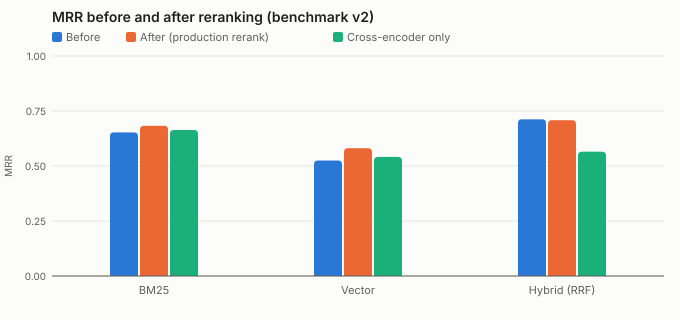

# Reranker evaluation: before vs after cross-encoder reranking

_Generated by `scripts/compare_retrieval.py`. Do not edit by hand; re-run the script._

- Generated: 2026-11-15T14:14:17+00:00
- Primary benchmark: `benchmark_v2.json` (v1 deltas at the end)
- Reranker: `cross-encoder/ms-marco-MiniLM-L-6-v2`; production formula: 0.7 * minmax(first-stage score) + 0.3 * minmax(cross-encoder score) (app/rag/reranker.py)
- Each reranked list is the base strategy's own pool of 20 distinct pages, reordered (identical candidates before and after).
- `+rerank` = production blend (what the assistant uses). `+ce` = the same pool sorted by the cross-encoder score alone (diagnostic, same model call).

## Overall (benchmark v2, measured)

| Comparison | MRR before | MRR after | Δ MRR | Hit@1 before | Hit@1 after | Hit@3 before | Hit@3 after | R@3 before | R@3 after | P@3 before | P@3 after | Improved/degraded/unchanged |
| --- | ---: | ---: | ---: | ---: | ---: | ---: | ---: | ---: | ---: | ---: | ---: | ---: |
| bm25 -> bm25+rerank | 0.653 | 0.683 | +0.030 | 0.500 | 0.500 | 0.727 | 0.818 | 0.682 | 0.773 | 0.273 | 0.303 | 6/0/16 |
| bm25 -> bm25+ce | 0.653 | 0.664 | +0.011 | 0.500 | 0.455 | 0.727 | 0.864 | 0.682 | 0.841 | 0.273 | 0.333 | 10/6/6 |
| vector -> vector+rerank | 0.525 | 0.581 | +0.056 | 0.273 | 0.364 | 0.682 | 0.727 | 0.636 | 0.705 | 0.242 | 0.273 | 8/0/14 |
| vector -> vector+ce | 0.525 | 0.541 | +0.017 | 0.273 | 0.318 | 0.682 | 0.727 | 0.636 | 0.682 | 0.242 | 0.288 | 9/8/5 |
| hybrid -> hybrid+rerank | 0.712 | 0.708 | -0.004 | 0.545 | 0.500 | 0.909 | 0.955 | 0.886 | 0.932 | 0.348 | 0.364 | 4/4/14 |
| hybrid -> hybrid+ce | 0.712 | 0.565 | -0.147 | 0.545 | 0.318 | 0.909 | 0.818 | 0.886 | 0.795 | 0.348 | 0.318 | 5/10/7 |

Verdict per question: reciprocal rank up = improved, down = degraded; ties are decided by summed fact recall over all K; otherwise unchanged.

## Does reranking improve top-1 and top-3 retrieval? (calculated)

- **bm25 -> bm25+rerank**: Hit@1 0.500 → 0.500 (+0.000), Hit@3 0.727 → 0.818 (+0.091), R@1 +0.000, R@3 +0.091.
- **bm25 -> bm25+ce**: Hit@1 0.500 → 0.455 (-0.045), Hit@3 0.727 → 0.864 (+0.136), R@1 -0.045, R@3 +0.159.
- **vector -> vector+rerank**: Hit@1 0.273 → 0.364 (+0.091), Hit@3 0.682 → 0.727 (+0.045), R@1 +0.091, R@3 +0.068.
- **vector -> vector+ce**: Hit@1 0.273 → 0.318 (+0.045), Hit@3 0.682 → 0.727 (+0.045), R@1 +0.091, R@3 +0.045.
- **hybrid -> hybrid+rerank**: Hit@1 0.545 → 0.500 (-0.045), Hit@3 0.909 → 0.955 (+0.045), R@1 -0.023, R@3 +0.045.
- **hybrid -> hybrid+ce**: Hit@1 0.545 → 0.318 (-0.227), Hit@3 0.909 → 0.818 (-0.091), R@1 -0.159, R@3 -0.091.

## Per-question changes (benchmark v2)

### bm25 -> bm25+rerank

Improved: Q001, Q009, Q011, Q018, Q019, Q022  
Degraded: none  
Unchanged: Q002, Q003, Q004, Q005, Q006, Q007, Q008, Q010, Q012, Q013, Q014, Q015, Q016, Q017, Q020, Q021  
Relevant evidence moved down: Q006, Q008

| ID | Category | First rel. rank before | after | RR Δ | Verdict | Relevant pages moved down (before→after) |
| --- | --- | ---: | ---: | ---: | --- | --- |
| Q001 | factual | 19 | 9 | +0.059 | improved |  |
| Q002 | factual | 1 | 1 | +0.000 | unchanged |  |
| Q003 | factual | 1 | 1 | +0.000 | unchanged |  |
| Q004 | factual | 1 | 1 | +0.000 | unchanged |  |
| Q005 | factual | 2 | 2 | +0.000 | unchanged |  |
| Q006 | numerical | 1 | 1 | +0.000 | unchanged | p172: 9→10 |
| Q007 | numerical | 1 | 1 | +0.000 | unchanged |  |
| Q008 | numerical | 2 | 2 | +0.000 | unchanged | p60: 8→11 |
| Q009 | numerical | 9 | 8 | +0.014 | improved |  |
| Q010 | numerical | 2 | 2 | +0.000 | unchanged |  |
| Q011 | financial | 4 | 2 | +0.250 | improved |  |
| Q012 | financial | 5 | 5 | +0.000 | unchanged |  |
| Q013 | financial | 1 | 1 | +0.000 | unchanged |  |
| Q014 | financial | 2 | 2 | +0.000 | unchanged |  |
| Q015 | financial | 1 | 1 | +0.000 | unchanged |  |
| Q016 | comparative | 1 | 1 | +0.000 | unchanged |  |
| Q017 | comparative | 1 | 1 | +0.000 | unchanged |  |
| Q018 | comparative | 4 | 3 | +0.083 | improved |  |
| Q019 | comparative | 3 | 2 | +0.167 | improved |  |
| Q020 | multi_hop | 1 | 1 | +0.000 | unchanged |  |
| Q021 | multi_hop | 1 | 1 | +0.000 | unchanged |  |
| Q022 | multi_hop | 6 | 4 | +0.083 | improved |  |

### bm25 -> bm25+ce

Improved: Q001, Q005, Q008, Q009, Q011, Q012, Q018, Q019, Q021, Q022  
Degraded: Q003, Q006, Q010, Q013, Q014, Q015  
Unchanged: Q002, Q004, Q007, Q016, Q017, Q020  
Relevant evidence moved down: Q002, Q003, Q006, Q008, Q010, Q013, Q014, Q015, Q017, Q018, Q021

| ID | Category | First rel. rank before | after | RR Δ | Verdict | Relevant pages moved down (before→after) |
| --- | --- | ---: | ---: | ---: | --- | --- |
| Q001 | factual | 19 | 3 | +0.281 | improved |  |
| Q002 | factual | 1 | 1 | +0.000 | unchanged | p59: 1→5, p201: 2→3 |
| Q003 | factual | 1 | 2 | -0.500 | degraded | p107: 1→2 |
| Q004 | factual | 1 | 1 | +0.000 | unchanged |  |
| Q005 | factual | 2 | 1 | +0.500 | improved |  |
| Q006 | numerical | 1 | 3 | -0.667 | degraded | p95: 1→3, p172: 9→13 |
| Q007 | numerical | 1 | 1 | +0.000 | unchanged |  |
| Q008 | numerical | 2 | 1 | +0.500 | improved | p60: 8→15 |
| Q009 | numerical | 9 | 5 | +0.089 | improved |  |
| Q010 | numerical | 2 | 3 | -0.167 | degraded | p29: 2→3 |
| Q011 | financial | 4 | 1 | +0.750 | improved |  |
| Q012 | financial | 5 | 2 | +0.300 | improved |  |
| Q013 | financial | 1 | 2 | -0.500 | degraded | p98: 1→3, p281: 3→4 |
| Q014 | financial | 2 | 5 | -0.300 | degraded | p67: 2→5 |
| Q015 | financial | 1 | 5 | -0.800 | degraded | p99: 1→5 |
| Q016 | comparative | 1 | 1 | +0.000 | unchanged |  |
| Q017 | comparative | 1 | 1 | +0.000 | unchanged | p3: 5→6 |
| Q018 | comparative | 4 | 2 | +0.250 | improved | p3: 6→8 |
| Q019 | comparative | 3 | 2 | +0.167 | improved |  |
| Q020 | multi_hop | 1 | 1 | +0.000 | unchanged |  |
| Q021 | multi_hop | 1 | 1 | +0.000 | improved | p95: 1→2 |
| Q022 | multi_hop | 6 | 2 | +0.333 | improved |  |

### vector -> vector+rerank

Improved: Q002, Q010, Q011, Q012, Q014, Q016, Q017, Q022  
Degraded: none  
Unchanged: Q001, Q003, Q004, Q005, Q006, Q007, Q008, Q009, Q013, Q015, Q018, Q019, Q020, Q021  
Relevant evidence moved down: Q002, Q006, Q007, Q017

| ID | Category | First rel. rank before | after | RR Δ | Verdict | Relevant pages moved down (before→after) |
| --- | --- | ---: | ---: | ---: | --- | --- |
| Q001 | factual | 1 | 1 | +0.000 | unchanged |  |
| Q002 | factual | 2 | 1 | +0.500 | improved | p201: 2→3 |
| Q003 | factual | 2 | 2 | +0.000 | unchanged |  |
| Q004 | factual | 2 | 2 | +0.000 | unchanged |  |
| Q005 | factual | 1 | 1 | +0.000 | unchanged |  |
| Q006 | numerical | 2 | 2 | +0.000 | unchanged | p172: 14→16 |
| Q007 | numerical | 1 | 1 | +0.000 | unchanged | p3: 4→7 |
| Q008 | numerical | 2 | 2 | +0.000 | unchanged |  |
| Q009 | numerical | 2 | 2 | +0.000 | unchanged |  |
| Q010 | numerical | 10 | 8 | +0.025 | improved |  |
| Q011 | financial | 8 | 5 | +0.075 | improved |  |
| Q012 | financial | 15 | 12 | +0.017 | improved |  |
| Q013 | financial | 2 | 2 | +0.000 | unchanged |  |
| Q014 | financial | 7 | 6 | +0.024 | improved |  |
| Q015 | financial | 1 | 1 | +0.000 | unchanged |  |
| Q016 | comparative | 2 | 1 | +0.500 | improved |  |
| Q017 | comparative | 9 | 8 | +0.014 | improved | p3: 9→13 |
| Q018 | comparative | 4 | 4 | +0.000 | unchanged |  |
| Q019 | comparative | 2 | 2 | +0.000 | unchanged |  |
| Q020 | multi_hop | 1 | 1 | +0.000 | unchanged |  |
| Q021 | multi_hop | 1 | 1 | +0.000 | unchanged |  |
| Q022 | multi_hop | 4 | 3 | +0.083 | improved |  |

### vector -> vector+ce

Improved: Q002, Q010, Q011, Q012, Q014, Q016, Q017, Q019, Q022  
Degraded: Q001, Q003, Q004, Q006, Q009, Q018, Q020, Q021  
Unchanged: Q005, Q007, Q008, Q013, Q015  
Relevant evidence moved down: Q001, Q002, Q003, Q004, Q006, Q007, Q009, Q017, Q018, Q020, Q021

| ID | Category | First rel. rank before | after | RR Δ | Verdict | Relevant pages moved down (before→after) |
| --- | --- | ---: | ---: | ---: | --- | --- |
| Q001 | factual | 1 | 6 | -0.833 | degraded | p3: 1→6 |
| Q002 | factual | 2 | 1 | +0.500 | improved | p201: 2→3 |
| Q003 | factual | 2 | 3 | -0.167 | degraded | p106: 8→16, p107: 2→3 |
| Q004 | factual | 2 | 10 | -0.400 | degraded | p3: 2→10 |
| Q005 | factual | 1 | 1 | +0.000 | unchanged |  |
| Q006 | numerical | 2 | 4 | -0.250 | degraded | p95: 2→4, p172: 14→18 |
| Q007 | numerical | 1 | 1 | +0.000 | unchanged | p3: 4→16 |
| Q008 | numerical | 2 | 2 | +0.000 | unchanged |  |
| Q009 | numerical | 2 | 6 | -0.333 | degraded | p3: 2→6 |
| Q010 | numerical | 10 | 2 | +0.400 | improved |  |
| Q011 | financial | 8 | 1 | +0.875 | improved |  |
| Q012 | financial | 15 | 3 | +0.267 | improved |  |
| Q013 | financial | 2 | 2 | +0.000 | unchanged |  |
| Q014 | financial | 7 | 4 | +0.107 | improved |  |
| Q015 | financial | 1 | 1 | +0.000 | unchanged |  |
| Q016 | comparative | 2 | 1 | +0.500 | improved |  |
| Q017 | comparative | 9 | 2 | +0.389 | improved | p3: 9→12 |
| Q018 | comparative | 4 | 7 | -0.107 | degraded | p3: 4→7 |
| Q019 | comparative | 2 | 1 | +0.500 | improved |  |
| Q020 | multi_hop | 1 | 3 | -0.667 | degraded | p95: 1→3 |
| Q021 | multi_hop | 1 | 3 | -0.667 | degraded | p3: 11→14, p130: 1→4 |
| Q022 | multi_hop | 4 | 2 | +0.250 | improved |  |

### hybrid -> hybrid+rerank

Improved: Q001, Q002, Q011, Q019  
Degraded: Q006, Q008, Q014, Q018  
Unchanged: Q003, Q004, Q005, Q007, Q009, Q010, Q012, Q013, Q015, Q016, Q017, Q020, Q021, Q022  
Relevant evidence moved down: Q002, Q006, Q007, Q008, Q014, Q017, Q018

| ID | Category | First rel. rank before | after | RR Δ | Verdict | Relevant pages moved down (before→after) |
| --- | --- | ---: | ---: | ---: | --- | --- |
| Q001 | factual | 3 | 2 | +0.167 | improved |  |
| Q002 | factual | 1 | 1 | +0.000 | improved | p201: 1→2 |
| Q003 | factual | 1 | 1 | +0.000 | unchanged |  |
| Q004 | factual | 1 | 1 | +0.000 | unchanged |  |
| Q005 | factual | 1 | 1 | +0.000 | unchanged |  |
| Q006 | numerical | 1 | 2 | -0.500 | degraded | p95: 1→2, p172: 5→10 |
| Q007 | numerical | 1 | 1 | +0.000 | unchanged | p3: 7→11 |
| Q008 | numerical | 1 | 2 | -0.500 | degraded | p3: 1→2 |
| Q009 | numerical | 3 | 3 | +0.000 | unchanged |  |
| Q010 | numerical | 3 | 3 | +0.000 | unchanged |  |
| Q011 | financial | 3 | 1 | +0.667 | improved |  |
| Q012 | financial | 4 | 4 | +0.000 | unchanged |  |
| Q013 | financial | 2 | 2 | +0.000 | unchanged |  |
| Q014 | financial | 2 | 3 | -0.167 | degraded | p67: 2→3 |
| Q015 | financial | 1 | 1 | +0.000 | unchanged |  |
| Q016 | comparative | 1 | 1 | +0.000 | unchanged |  |
| Q017 | comparative | 3 | 3 | +0.000 | unchanged | p3: 3→4 |
| Q018 | comparative | 1 | 2 | -0.500 | degraded | p3: 1→2 |
| Q019 | comparative | 4 | 1 | +0.750 | improved |  |
| Q020 | multi_hop | 1 | 1 | +0.000 | unchanged |  |
| Q021 | multi_hop | 1 | 1 | +0.000 | unchanged |  |
| Q022 | multi_hop | 2 | 2 | +0.000 | unchanged |  |

### hybrid -> hybrid+ce

Improved: Q002, Q011, Q012, Q017, Q019  
Degraded: Q001, Q003, Q004, Q006, Q008, Q009, Q014, Q018, Q020, Q021  
Unchanged: Q005, Q007, Q010, Q013, Q015, Q016, Q022  
Relevant evidence moved down: Q001, Q002, Q003, Q004, Q006, Q007, Q008, Q009, Q014, Q016, Q017, Q018, Q020, Q021

| ID | Category | First rel. rank before | after | RR Δ | Verdict | Relevant pages moved down (before→after) |
| --- | --- | ---: | ---: | ---: | --- | --- |
| Q001 | factual | 3 | 6 | -0.167 | degraded | p3: 3→6 |
| Q002 | factual | 1 | 1 | +0.000 | improved | p59: 3→6, p201: 1→3 |
| Q003 | factual | 1 | 3 | -0.667 | degraded | p106: 16→18, p107: 1→3 |
| Q004 | factual | 1 | 2 | -0.500 | degraded | p3: 1→2 |
| Q005 | factual | 1 | 1 | +0.000 | unchanged |  |
| Q006 | numerical | 1 | 4 | -0.750 | degraded | p95: 1→4, p172: 5→17 |
| Q007 | numerical | 1 | 1 | +0.000 | unchanged | p3: 7→20 |
| Q008 | numerical | 1 | 2 | -0.500 | degraded | p3: 1→2 |
| Q009 | numerical | 3 | 7 | -0.190 | degraded | p3: 3→7 |
| Q010 | numerical | 3 | 3 | +0.000 | unchanged |  |
| Q011 | financial | 3 | 1 | +0.667 | improved |  |
| Q012 | financial | 4 | 3 | +0.083 | improved |  |
| Q013 | financial | 2 | 2 | +0.000 | unchanged |  |
| Q014 | financial | 2 | 5 | -0.300 | degraded | p67: 2→5 |
| Q015 | financial | 1 | 1 | +0.000 | unchanged |  |
| Q016 | comparative | 1 | 1 | +0.000 | unchanged | p172: 9→12 |
| Q017 | comparative | 3 | 2 | +0.167 | improved | p3: 3→9 |
| Q018 | comparative | 1 | 3 | -0.667 | degraded | p3: 1→8 |
| Q019 | comparative | 4 | 1 | +0.750 | improved |  |
| Q020 | multi_hop | 1 | 3 | -0.667 | degraded | p95: 1→3 |
| Q021 | multi_hop | 1 | 2 | -0.500 | degraded | p95: 1→2, p130: 2→3 |
| Q022 | multi_hop | 2 | 2 | +0.000 | unchanged |  |

## Category-level MRR change (benchmark v2, production rerank)

| Category | BM25 before → after | Vector before → after | Hybrid (RRF) before → after |
| --- | ---: | ---: | ---: |
| factual | 0.711 → 0.722 | 0.700 → 0.800 | 0.867 → 0.900 |
| numerical | 0.622 → 0.625 | 0.520 → 0.525 | 0.733 → 0.533 |
| financial | 0.590 → 0.640 | 0.367 → 0.390 | 0.517 → 0.617 |
| comparative | 0.646 → 0.708 | 0.340 → 0.469 | 0.646 → 0.708 |
| multi_hop | 0.722 → 0.750 | 0.750 → 0.778 | 0.833 → 0.833 |

## Benchmark v1 (baseline) deltas

| Comparison | MRR before | MRR after | Δ MRR | Hit@1 before | Hit@1 after | Hit@3 before | Hit@3 after | R@3 before | R@3 after | P@3 before | P@3 after | Improved/degraded/unchanged |
| --- | ---: | ---: | ---: | ---: | ---: | ---: | ---: | ---: | ---: | ---: | ---: | ---: |
| bm25 -> bm25+rerank | 0.653 | 0.683 | +0.030 | 0.500 | 0.500 | 0.727 | 0.818 | 0.682 | 0.773 | 0.273 | 0.303 | 6/0/16 |
| bm25 -> bm25+ce | 0.653 | 0.664 | +0.011 | 0.500 | 0.455 | 0.727 | 0.864 | 0.682 | 0.841 | 0.273 | 0.333 | 10/6/6 |
| vector -> vector+rerank | 0.511 | 0.570 | +0.059 | 0.273 | 0.364 | 0.682 | 0.727 | 0.636 | 0.705 | 0.242 | 0.273 | 8/0/14 |
| vector -> vector+ce | 0.511 | 0.535 | +0.024 | 0.273 | 0.318 | 0.682 | 0.727 | 0.636 | 0.682 | 0.242 | 0.288 | 9/7/6 |
| hybrid -> hybrid+rerank | 0.667 | 0.691 | +0.024 | 0.500 | 0.500 | 0.818 | 0.909 | 0.795 | 0.886 | 0.318 | 0.348 | 6/3/13 |
| hybrid -> hybrid+ce | 0.667 | 0.565 | -0.102 | 0.500 | 0.318 | 0.818 | 0.818 | 0.795 | 0.795 | 0.318 | 0.318 | 6/9/7 |
