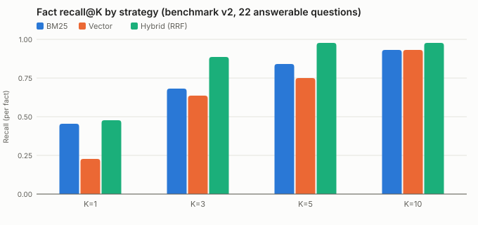
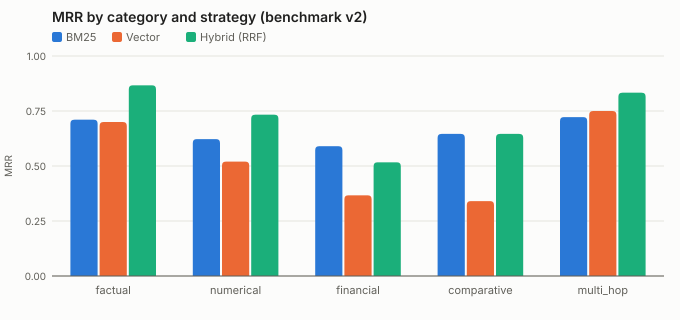

# Retrieval strategy comparison: BM25 vs vector vs hybrid

_Generated by `scripts/compare_retrieval.py`. Do not edit by hand; re-run the script._

- Generated: 2026-11-15T14:14:17+00:00
- Primary benchmark: `benchmark_v2.json`; baseline: `benchmark_v1.json`
- Questions: 22 answerable scored, 3 unanswerable reported separately
- K values: 1, 3, 5, 10 (K counts distinct (source, page) units)

## Setup (measured configuration)

| Setting | Value |
| --- | --- |
| candidate_k | 50 |
| max_candidate_k | 400 |
| pool_size | 20 |
| include_rerank | true |
| pdf | annual_report.pdf |
| num_chunks | 781 |
| embedding_model | BAAI/bge-small-en-v1.5 |
| vector_collection | insightrag_documents |
| bm25_weight | 0.4 |
| vector_weight | 0.6 |
| rrf_rank_constant | 60 |
| query_expansion | app.rag.query_expander.expand_query (all base strategies) |
| reranker_model | cross-encoder/ms-marco-MiniLM-L-6-v2 |
| rerank_formula | 0.7 * minmax(first-stage score) + 0.3 * minmax(cross-encoder score) (app/rag/reranker.py) |

Every strategy is reduced to its top 20 distinct pages before scoring. BM25 and vector fetch more chunks (from 50 up to 400) until that many distinct pages are available; hybrid is page-diverse and is called exactly as in `app/main.py`.
Pools with fewer than 10 distinct pages: none. Errors: none.

## Overall results (benchmark v2, measured)

R = fact recall, PR = page recall, P = precision, all at K distinct pages.

| Strategy | R@1 | R@3 | R@5 | R@10 | PR@1 | PR@3 | PR@5 | PR@10 | P@1 | P@3 | P@5 | P@10 | MRR |
| --- | ---: | ---: | ---: | ---: | ---: | ---: | ---: | ---: | ---: | ---: | ---: | ---: | ---: |
| BM25 | 0.455 | 0.682 | 0.841 | 0.932 | 0.326 | 0.485 | 0.651 | 0.720 | 0.500 | 0.273 | 0.227 | 0.141 | 0.653 |
| Vector | 0.227 | 0.636 | 0.750 | 0.932 | 0.204 | 0.462 | 0.500 | 0.599 | 0.273 | 0.242 | 0.182 | 0.118 | 0.525 |
| Hybrid (RRF) | 0.477 | 0.886 | 0.977 | 0.977 | 0.333 | 0.530 | 0.682 | 0.705 | 0.545 | 0.348 | 0.255 | 0.136 | 0.712 |

Hit rate@K (share of questions with a relevant page in the top K):

| Strategy | Hit@1 | Hit@3 | Hit@5 | Hit@10 |
| --- | ---: | ---: | ---: | ---: |
| BM25 | 0.500 | 0.727 | 0.864 | 0.955 |
| Vector | 0.273 | 0.682 | 0.773 | 0.955 |
| Hybrid (RRF) | 0.545 | 0.909 | 1.000 | 1.000 |

## Best strategy per metric (calculated from the table above)

| Metric | Best |
| --- | --- |
| MRR | Hybrid (RRF) |
| Recall@1 | Hybrid (RRF) |
| Recall@3 | Hybrid (RRF) |
| Recall@5 | Hybrid (RRF) |
| Recall@10 | Hybrid (RRF) |
| Precision@1 | Hybrid (RRF) |
| Precision@3 | Hybrid (RRF) |
| Precision@5 | Hybrid (RRF) |
| Precision@10 | BM25 |

## Category-level results (benchmark v2)

| Category | n | BM25 R@3 | BM25 MRR | Vector R@3 | Vector MRR | Hybrid (RRF) R@3 | Hybrid (RRF) MRR |
| --- | ---: | ---: | ---: | ---: | ---: | ---: | ---: |
| factual | 5 | 0.800 | 0.711 | 0.900 | 0.700 | 1.000 | 0.867 |
| numerical | 5 | 0.800 | 0.622 | 0.800 | 0.520 | 1.000 | 0.733 |
| financial | 5 | 0.600 | 0.590 | 0.400 | 0.367 | 0.800 | 0.517 |
| comparative | 4 | 0.750 | 0.646 | 0.500 | 0.340 | 0.750 | 0.646 |
| multi_hop | 3 | 0.333 | 0.722 | 0.500 | 0.750 | 0.833 | 0.833 |

## Per-question first relevant rank (benchmark v2)

Rank of the first relevant distinct page (— = none in the pool of 20).

| ID | Category | Relevant pages | BM25 | Vector | Hybrid (RRF) |
| --- | --- | --- | ---: | ---: | ---: |
| Q001 | factual | 3 | 19 | 1 | 3 |
| Q002 | factual | 59, 94, 201 | 1 | 2 | 1 |
| Q003 | factual | 106, 107 | 1 | 2 | 1 |
| Q004 | factual | 3 | 1 | 2 | 1 |
| Q005 | factual | 3 | 2 | 1 | 1 |
| Q006 | numerical | 95, 172 | 1 | 2 | 1 |
| Q007 | numerical | 3, 130 | 1 | 1 | 1 |
| Q008 | numerical | 3, 60 | 2 | 2 | 1 |
| Q009 | numerical | 3, 95 | 9 | 2 | 3 |
| Q010 | numerical | 29, 212 | 2 | 10 | 3 |
| Q011 | financial | 95, 172 | 4 | 8 | 3 |
| Q012 | financial | 172 | 5 | 15 | 4 |
| Q013 | financial | 98, 172, 281 | 1 | 2 | 2 |
| Q014 | financial | 67, 176, 203 | 2 | 7 | 2 |
| Q015 | financial | 99 | 1 | 1 | 1 |
| Q016 | comparative | 95, 172 | 1 | 2 | 1 |
| Q017 | comparative | 3, 95 | 1 | 9 | 3 |
| Q018 | comparative | 3, 95 | 4 | 4 | 1 |
| Q019 | comparative | 95, 172 | 3 | 2 | 4 |
| Q020 | multi_hop | 95, 130 | 1 | 1 | 1 |
| Q021 | multi_hop | 3, 95, 130, 172 | 1 | 1 | 1 |
| Q022 | multi_hop | 3, 60, 95 | 6 | 4 | 2 |

## Where each strategy fails (calculated)

| Strategy | No relevant page in top 3 | No relevant page in top 10 | A fact still missing at K=10 |
| --- | --- | --- | --- |
| BM25 | Q001, Q009, Q011, Q012, Q018, Q022 | Q001 | Q001, Q020 |
| Vector | Q010, Q011, Q012, Q014, Q017, Q018, Q022 | Q012 | Q012, Q020 |
| Hybrid (RRF) | Q012, Q019 | none | Q020 |

## Benchmark correction impact (v1 → v2)

v2 adds page 3 as alternative evidence for Q017/Q018 (see `benchmark_v2_changes.md`). Same rankings, scored twice:

| Strategy | MRR v1 | MRR v2 | R@3 v1 | R@3 v2 | P@3 v1 | P@3 v2 |
| --- | ---: | ---: | ---: | ---: | ---: | ---: |
| BM25 | 0.653 | 0.653 | 0.682 | 0.682 | 0.273 | 0.273 |
| Vector | 0.511 | 0.525 | 0.636 | 0.636 | 0.242 | 0.242 |
| Hybrid (RRF) | 0.667 | 0.712 | 0.795 | 0.886 | 0.318 | 0.348 |
| BM25 + rerank | 0.683 | 0.683 | 0.773 | 0.773 | 0.303 | 0.303 |
| Vector + rerank | 0.570 | 0.581 | 0.705 | 0.705 | 0.273 | 0.273 |
| Hybrid + rerank (production) | 0.691 | 0.708 | 0.886 | 0.932 | 0.348 | 0.364 |
| BM25 + CE only | 0.664 | 0.664 | 0.841 | 0.841 | 0.333 | 0.333 |
| Vector + CE only | 0.535 | 0.541 | 0.682 | 0.682 | 0.288 | 0.288 |
| Hybrid + CE only | 0.565 | 0.565 | 0.795 | 0.795 | 0.318 | 0.318 |

Overall results on v1 (for comparison with the Task 2 baseline):

| Strategy | R@1 | R@3 | R@5 | R@10 | PR@1 | PR@3 | PR@5 | PR@10 | P@1 | P@3 | P@5 | P@10 | MRR |
| --- | ---: | ---: | ---: | ---: | ---: | ---: | ---: | ---: | ---: | ---: | ---: | ---: | ---: |
| BM25 | 0.455 | 0.682 | 0.841 | 0.932 | 0.326 | 0.485 | 0.651 | 0.720 | 0.500 | 0.273 | 0.218 | 0.132 | 0.653 |
| Vector | 0.227 | 0.636 | 0.705 | 0.841 | 0.204 | 0.462 | 0.500 | 0.599 | 0.273 | 0.242 | 0.173 | 0.109 | 0.511 |
| Hybrid (RRF) | 0.432 | 0.795 | 0.932 | 0.932 | 0.333 | 0.530 | 0.682 | 0.705 | 0.500 | 0.318 | 0.236 | 0.127 | 0.667 |
| BM25 + rerank | 0.455 | 0.773 | 0.886 | 0.977 | 0.326 | 0.553 | 0.651 | 0.758 | 0.500 | 0.303 | 0.227 | 0.136 | 0.683 |
| Vector + rerank | 0.318 | 0.705 | 0.750 | 0.886 | 0.265 | 0.477 | 0.500 | 0.659 | 0.364 | 0.273 | 0.173 | 0.118 | 0.570 |
| Hybrid + rerank (production) | 0.455 | 0.886 | 0.932 | 0.977 | 0.333 | 0.599 | 0.659 | 0.727 | 0.500 | 0.348 | 0.227 | 0.132 | 0.691 |
| BM25 + CE only | 0.409 | 0.841 | 0.977 | 0.977 | 0.311 | 0.606 | 0.720 | 0.735 | 0.455 | 0.333 | 0.255 | 0.136 | 0.664 |
| Vector + CE only | 0.318 | 0.682 | 0.795 | 0.932 | 0.220 | 0.492 | 0.568 | 0.682 | 0.318 | 0.288 | 0.209 | 0.123 | 0.535 |
| Hybrid + CE only | 0.318 | 0.795 | 0.886 | 0.977 | 0.220 | 0.583 | 0.621 | 0.705 | 0.318 | 0.318 | 0.218 | 0.123 | 0.565 |

Task 2 baseline reproduction: hybrid+rerank on v1 gives MRR 0.691 vs Task 2 0.691; all recall/page-recall/precision values identical.

## Unanswerable questions (retrieval only, not scored)

These questions have no evidence pages. The table shows whether near-miss (distractor) pages, which hold related but non-answering figures, reach the top 5.

| ID | Distractor pages | BM25 | Vector | Hybrid (RRF) |
| --- | --- | --- | --- | --- |
| Q023 | 5, 67, 95 | 95 | 95 | 95 |
| Q024 | 95, 172 | 95 | none | 95 |
| Q025 | 8, 118, 119, 121 | 119 | 119 | 119 |

Retrieval always returns pages; whether the system abstains is decided after generation and is evaluated in the answer-quality report.
